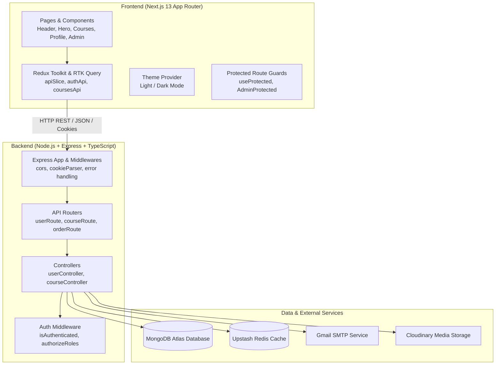

# 00 - Project Overview: Learning Management System (LMS)

## 1. Project Purpose
The Learning Management System (LMS) is a modern, responsive, full-stack educational platform inspired by Becodemy's industrial-grade MERN/Next.js LMS architecture. The application is designed to allow students to browse, enroll in, and watch video-based courses, interact with instructors via Q&A and reviews, and manage their learner profiles. Instructors and administrators can manage users, publish and update courses with structured curriculum and video previews, track analytics, and handle student enrollments.

---

## 2. Technology Stack

### Frontend (Client)
- **Framework:** Next.js 13/14 (React 18 / App Router architecture)
- **Language:** TypeScript
- **Styling:** Tailwind CSS + `next-themes` (Dark/Light mode support)
- **State Management & Data Fetching:** Redux Toolkit & RTK Query
- **Form Handling & Validation:** Formik & Yup
- **UI Components & Icons:** React Icons (`react-icons/bi`, `react-icons/ai`, `react-icons/fc`, `react-icons/md`, `react-icons/hi`), Material UI (`@mui/material`, `@mui/icons-material`, `@mui/x-data-grid`)
- **Notifications:** React Hot Toast
- **Media Player:** Video player integration for course previews and lectures

### Backend (Server)
- **Runtime & Framework:** Node.js + Express.js with TypeScript (`ts-node-dev`)
- **Database:** MongoDB with Mongoose ODM (Atlas Cloud Cluster connected)
- **Cache & Session Management:** Redis (Upstash Redis integration via `ioredis`)
- **Authentication & Security:** JWT (Access & Refresh tokens with cookie and payload transport), bcryptjs password hashing
- **Email Delivery:** Nodemailer + EJS templates for activation OTP emails
- **Asset Storage:** Cloudinary integration for profile avatars and course media

---

## 3. High-Level Architecture



---

## 4. Current Repository State & Discovery Findings
During our Stage 1 inspection:
1. **Frontend (`client/`)**: Initially an empty directory awaiting proper Next.js 13 App Router setup matching the Becodemy tutorial architecture.
2. **Backend (`server/`)**: An existing TypeScript Express project:
   - Configured with Mongoose connected to MongoDB Atlas.
   - Redis connected via `ioredis`.
   - Email activation via EJS and Nodemailer.
   - Implemented user registration, OTP activation, login, and initial logout.
   - Identified items requiring completion:
     - `server/routes/userRoute.ts` had a trailing unfinished `router.post` statement.
     - `server/middleware/auth.ts` was an empty file (0 bytes), needing `isAuthenticated` and `authorizeRoles` middlewares.
     - `server/@types/custom.ts` was empty (needs Express Request augmentation for authenticated user).
     - Additional endpoints for fetching current user profile (`/me`), editing profile, updating password, and managing courses are necessary to fulfill the full tutorial integration.

---

## 5. How to Run the Project (High Level)

### Prerequisites
- Node.js (v18+ recommended; system running v24.15.0)
- npm (v9+ recommended; system running v12.0.2)

### Starting the Backend
```bash
cd server
npm install
npm run dev
# Server listens on port 5000 (connected to MongoDB and Redis)
```

### Starting the Frontend
```bash
cd client
npm install
npm run dev
# Frontend runs on http://localhost:3000
```
