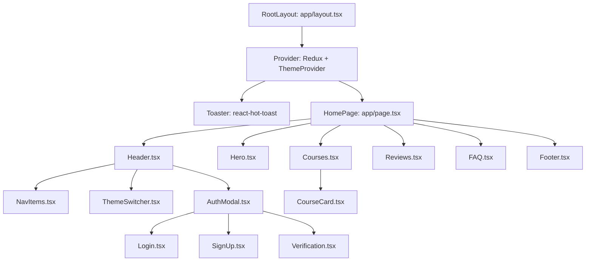

# 03 - Frontend Architecture Guide

## 1. Directory Structure
The frontend application lives inside `client/` and adopts the Next.js 13/14 App Router pattern:

```
client/
├── app/
│   ├── layout.tsx              # Root HTML layout, font setup, providers
│   ├── page.tsx                # Homepage featuring Header, Hero, Course cards, Reviews, FAQ, Footer
│   ├── globals.css             # Tailwind directives and custom utility classes
│   ├── Provider.tsx            # Redux Provider and Next-Themes wrapper
│   ├── profile/
│   │   └── page.tsx            # Authenticated user profile dashboard
│   ├── admin/
│   │   └── page.tsx            # Administrator dashboard and course manager
│   ├── courses/
│   │   └── page.tsx            # Course catalog browsing page with filters
│   ├── course/
│   │   └── [id]/
│   │       └── page.tsx        # Dynamic course details page with overview & preview
│   ├── course-access/
│   │   └── [id]/
│   │       └── page.tsx        # Enrolled student learning room with video player & Q&A
│   ├── about/
│   │   └── page.tsx            # About platform page
│   ├── faq/
│   │   └── page.tsx            # Dedicated FAQ page
│   ├── policy/
│   │   └── page.tsx            # Terms of service and privacy policy
│   ├── components/
│   │   ├── Header.tsx          # Top navigation, theme switcher, auth modal triggers
│   │   ├── NavItems.tsx        # Responsive navigation links
│   │   ├── ThemeSwitcher.tsx   # Light/dark mode toggle button
│   │   ├── Footer.tsx          # Reusable site footer
│   │   ├── Route/
│   │   │   ├── Hero.tsx        # Hero banner with search and social proof
│   │   │   ├── Courses.tsx     # Featured courses section
│   │   │   ├── Reviews.tsx     # Student testimonials and ratings
│   │   │   └── FAQ.tsx         # Frequently asked questions accordion
│   │   ├── Auth/
│   │   │   ├── AuthModal.tsx   # Accessible dialog container with backdrop blur
│   │   │   ├── Login.tsx       # Login form with Formik & Yup validation
│   │   │   ├── SignUp.tsx      # Registration form
│   │   │   └── Verification.tsx # OTP activation digit inputs
│   │   ├── Profile/
│   │   │   ├── Profile.tsx     # Profile tab coordinator
│   │   │   ├── SidebarProfile.tsx # Sidebar menu (Account, Password, Courses, Logout)
│   │   │   ├── ProfileInfo.tsx # User info and avatar upload
│   │   │   └── ChangePassword.tsx # Password modification form
│   │   ├── Course/
│   │   │   ├── CourseCard.tsx  # Course presentation card with badges
│   │   │   ├── CourseDetails.tsx # Detailed syllabus, benefits, prerequisites
│   │   │   ├── CoursePlayer.tsx # Video playback component
│   │   │   └── CourseContent.tsx # Student classroom with video and discussion tabs
│   │   └── Admin/
│   │       ├── AdminHeader.tsx # Admin top bar with notifications
│   │       ├── sidebar/
│   │       │   └── AdminSidebar.tsx # Admin navigation sidebar
│   │       ├── DashboardHero.tsx # Dashboard overview metrics
│   │       └── Course/
│   │           ├── CreateCourse.tsx # Multi-step course creation wizard
│   │           ├── CourseInformation.tsx # Step 1: metadata
│   │           ├── CourseOptions.tsx     # Step 2: benefits & prerequisites
│   │           ├── CourseContentData.tsx # Step 3: curriculum & video links
│   │           └── CoursePreview.tsx     # Step 4: course summary preview
│   └── hooks/
│       ├── useProtected.tsx    # Higher-order authentication guard
│       └── adminProtected.tsx  # Role-based administrator guard
├── redux/
│   ├── store.ts                # Redux Toolkit store definition
│   └── features/
│       ├── api/
│       │   └── apiSlice.ts     # Base RTK Query API slice with tag invalidation
│       ├── auth/
│       │   ├── authSlice.ts    # User session and token state
│       │   └── authApi.ts      # Authentication endpoints (login, register, activation, me, logout)
│       └── courses/
│           └── coursesApi.ts   # Course endpoints (get, getById, create)
├── public/                     # Static assets (favicons, logos, banner graphics)
├── tailwind.config.ts          # Tailwind color tokens, dark mode class, typography
├── tsconfig.json               # TypeScript compiler paths & strict configuration
└── package.json                # Dependencies and npm run scripts
```

---

## 2. Component Hierarchy & Flow



---

## 3. State Management with RTK Query
RTK Query manages all remote API synchronization:
- `apiSlice`: Manages the root base query with automatic credential inclusion (`credentials: "include"`) and header token attachment.
- `authApi`: Injects `registerUser`, `activateUser`, `loginUser`, `loadUser`, `updateProfile`, `updatePassword`, and `logoutUser`.
- `authSlice`: Synchronizes global user session state (`user`, `token`, `isAuthenticated`).
- `coursesApi`: Injects `getAllCourses`, `getCourseDetails`, `createCourse`, and `getCourseContent`.
