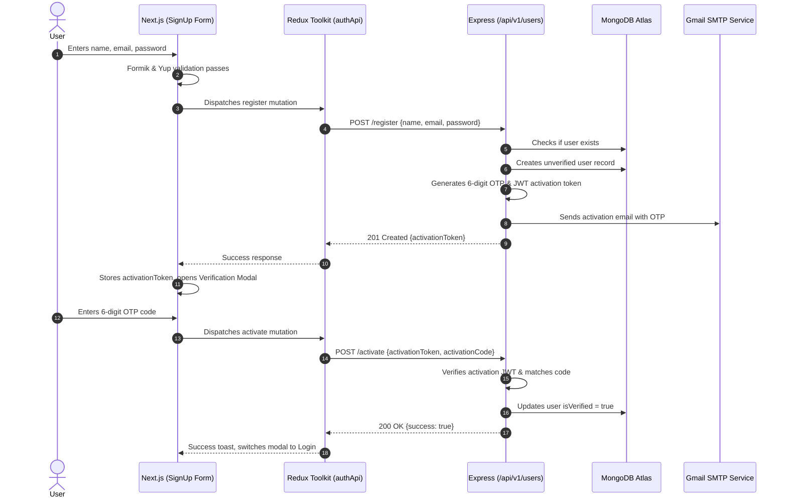
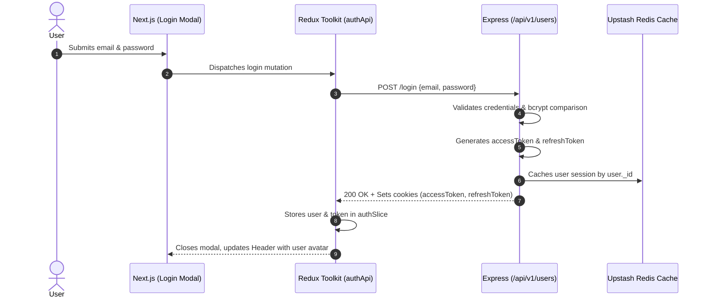
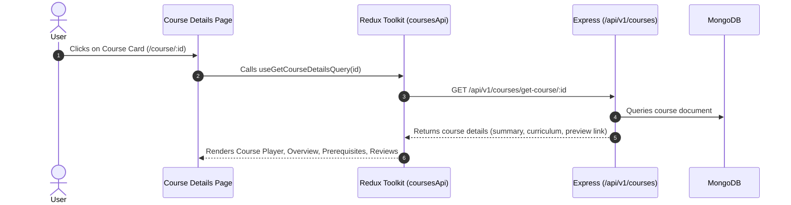

# 07 - Execution Flow & User Journeys

This document details key end-to-end user journeys through the application, tracing the path from UI interactions through Redux, HTTP transport, Express middleware, database, and back to UI updates.

---

## 1. User Registration & Activation Flow

---

## 2. User Authentication & Session Hydration Flow

---

## 3. Course Exploration & Details Flow

